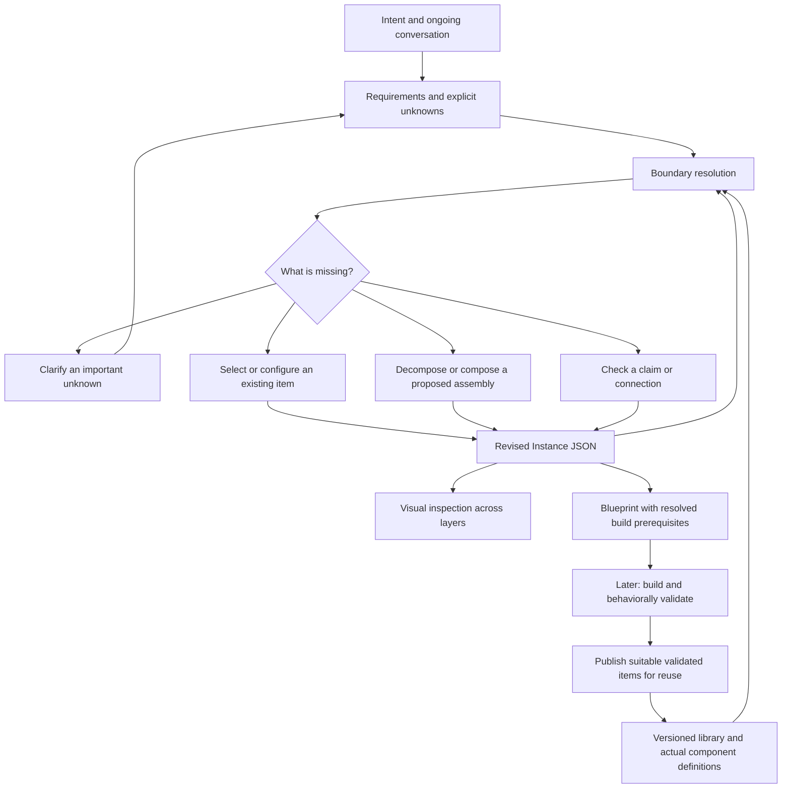

# Instance Machine Strategy

## The destination

You describe an outcome. Through conversation, the machine develops an instance: an inspectable, versioned design that explains what is required, how available pieces fit together, what is missing, and what could be built next.

Its first useful output is a grounded, buildable JSON blueprint. Execution is a later capability with its own checks. An incomplete design can still be useful if its unresolved parts are explicit.

The machine must help discover the design. It must not require you to know every requirement, choose every component, or supply a complete architecture before it can help.

**This is a proposed strategy for discussion, not a claim that these capabilities already work.** It follows accepted domain principles but proposes the order of delivery and the example below. It changes no running application or saved instance.

## The central mechanism

**Clarify intent → describe requirements → compare with the library → locate a boundary → refine the affected design → check again.**

At an unsupported boundary, the next action might be to ask one important question, select an existing item, decompose a requirement, combine lower items, configure a resource, or define a check. The machine revisits affected parts until the targeted design is coherent or the remaining blocker is explicit.

This is an iterative loop, not a one-shot prompt. It can work from the top, bottom, or an intermediate layer. It uses only the layers needed for the intent.

## What each part contributes

| Part | Responsibility |
| --- | --- |
| Library JSON | Describes what can be selected, its boundaries, versions, dependencies, and implementation status |
| Instance JSON | Records the intent-specific design, selections, assemblies, decisions, and unresolved boundaries |
| Conversation and discovery skills | Help clarify intent and propose meaningful changes without silently treating guesses as facts |
| Deterministic checks | Resolve references and versions, check structural rules, and identify specifically checkable gaps |
| Boundary resolution | Chooses the affected location and the next justified action; early versions can use an explicit policy rather than a learned optimizer |
| Canvas | Makes the same design understandable and editable at different layers |
| Langflow integration | Supplies native components, configuration mechanisms, and later executable graph construction |

AI proposes meanings and candidate assemblies. Deterministic rules enforce defined structural relationships. Behavioral testing supplies evidence. No one of these can substitute for the others.

The desired long-term loop can learn from reusable successes. DreamCoder integration, automatic abstraction learning, and Harness² tuning are separate research options, not prerequisites for establishing this first loop.

## Where we actually are

Source inspection and recorded project checks establish the following starting point; this strategy does not rerun live services:

- The prototype has layer navigation and a native Langflow component adapter.
- Named Custom assemblies are saved as browser-local graph snapshots. That is useful storage, but not yet a canonical instance registry.
- The project contains bounded execution demonstrations and a custom search provider that returns source links and snippets. Search snippets are not full-paper research.
- The Library JSON and Instance JSON examples are illustrative design fixtures. They are not snapshots of the actual installed component catalog.
- Higher-layer names do not by themselves provide executable capabilities. General nested-composite execution is still missing.
- A complete discovery → boundary resolution → canonical design → build/reuse mechanism has not been implemented.

Source references: [native adapter notes](../../frontend/prototype-canvas/langflow-adapter/README.md), [search provider notes](../../frontend/prototype-canvas/components/README.md), [canonical specification](canonical-specification.md).

## Delivery sequence: prove a useful capability at each step

### 1. Establish a truthful JSON foundation

**Purpose:** make the design refer to actual pieces rather than invented catalog entries.

Resolve a bounded selection of real Langflow definitions, their native contracts and configuration needs. Represent them as pinned library items. Describe one intent-specific assembly using those items. Define only the common fields and contract rules needed for this case, keeping wider questions explicit.

**Proof:** an actual component reference resolves; a nonexistent reference fails; a missing resource binding is shown as a configuration gap; incomplete drafts can be saved and reopened without being labeled buildable.

**Deliverables:** first formal schemas, pinned definition artifacts, semantic checks, and a real instance record. Loading an illustrative file alone does not pass this milestone.

### 2. Make the iterative design loop work

**Purpose:** convert a changing conversation into a progressively more grounded design.

Given the intent and the available library, propose requirements, selections, local candidates, and connections. Apply changes through a shared revision procedure. Record why a boundary is unresolved and what action could close it. Start with a bounded decision policy and explicit budgets; stop with a useful unresolved boundary if progress requires information or an unsupported capability.

**Proof:** introduce one missing capability and one meaningful change in the request. The machine identifies the affected part, proposes a justified revision, and retains unaffected work. It must not invent a library item, claim evidence it lacks, or loop indefinitely.

**Deliverables:** discovery-to-patch interface, boundary records, traceable design revisions, and deterministic change checks. This milestone may produce a buildable blueprint without executing it.

### 3. Make that design visually understandable and editable

**Purpose:** let you inspect and shape the machine without reading the full JSON.

Project the canonical records into the library and instance planes. Show proposed versus available pieces, horizontal connections, vertical boundary mappings, and unresolved gaps. Opening a higher item reveals the lower assembly realizing it. Canvas edits and agent edits use the same revision path.

**Proof:** JSON → visual inspection → semantic edit → revised JSON → reopen preserves the design. An invalid connection identifies its reason. A concurrent stale edit cannot silently overwrite another revision. Layout changes remain distinguishable from semantic changes.

**Deliverables:** a synchronized visual design surface, not a second source of truth. Visual exploration can happen alongside step two once the necessary records exist; it need not wait for a general compiler.

### 4. Build, validate, and reuse one capability

**Purpose:** demonstrate that a valid design can become useful behavior.

Translate the resolved assembly into a native Langflow artifact, execute within its configured limits, and attach results and bounded evidence to the exact instance checkpoint. Validate the composite boundary as well as its internal pieces. Package a suitable result as a versioned library item.

**Proof:** the saved item is selected by another assembly or instance, preserving its definition while isolating run state. A real tool failure remains visible as failure. Reopening preserves configuration references and evidence links without carrying unrelated execution history.

**Deliverables:** the first working recursive composition and reuse path. This is where saved higher-plane blocks acquire execution semantics rather than remaining labels.

### 5. Compose independently scoped instances

**Purpose:** support your proposed four specialized instances and a fifth coordinating business instance.

Define the interfaces between instances, version pinning, permitted sharing, independent state, and failure propagation. Reuse the same principles of contracts and validation; do not assume a higher business layer automatically supplies them.

**Proof:** one specialized instance can change through an explicit revision without silently changing its consumers; a failure identifies which dependent behavior is affected. The coordinating instance has its own acceptance checks.

**Deliverables:** a tested instance-composition mechanism. Broader business coverage grows through demonstrated capabilities rather than filling every plane with names.

## One example to react to: Online Research Desk

This is a proposed design example, not a selected commercial strategy or a claim of customer demand or profitability. It fits the preference for digital delivery and written communication.

**Starting intent:** “I want an online service that turns public information into useful research briefs and keeps them up to date, without meetings.”

Your idea of four instances and a fifth coordinator could appear like this:

| Instance | Its independent job | Its output |
| --- | --- | --- |
| Research | Investigate a scoped question and record evidence limits | Findings and source references |
| Product preparation | Turn suitable findings into a consistently structured deliverable | A report or data product candidate |
| Digital delivery | Manage permitted access and delivery of an approved product | Delivery/access result |
| Monitoring | Detect meaningful changes in the chosen sources | A change event and a proposed research request |
| Coordinating business instance | Connect these jobs for one offering and track whether the required outcomes are achieved | A coherent design and later operational results |

These boundaries are proposals. They can change when the example reveals better responsibilities. They are not new mandatory library layers or four kinds of business everyone needs.

### Walk through one piece before building all five

1. You describe the research outcome: “Give me a sourced brief answering this question.”
2. Discovery clarifies the question and any consequential choice; other unknowns remain recorded.
3. The machine compares the requirement with available items. Small Search and Synthesize is a candidate capability, subject to exporting and pinning its actual saved definition. Its declared boundary is source snippets and synthesis.
4. If the requirement only needs snippet-based findings, the candidate might fit. If it requires reading full documents, the machine exposes a precise capability gap. It does not rename the candidate “deep research” to hide the missing behavior.
5. The instance records a proposed retrieval/reading assembly below the relevant higher capability. Existing components are considered; missing definitions, extraction support, configuration, and checks remain explicit.
6. The loop refines that part until its blueprint is grounded or a blocker is clearly stated. It does not fill unused Enterprise, Program, or other planes just to complete a tower.
7. Later construction and validation can establish a reusable source-reading capability. Future research instances can select that validated revision rather than rediscovering it.

**What you would see:** the requested capability above, the available snippet-search item below, and a visible unresolved boundary between them. As that boundary is resolved, the proposed assembly becomes connected and its readiness changes for specific reasons.

The first strategic test is whether the machine can represent and resolve that boundary truthfully—not whether it can draw a large graph or operate a complete business immediately.

## How this uses the existing documents

| Document | Its job in this strategy |
| --- | --- |
| [Domain Model](domain-model.md) | Keep meanings and responsibility boundaries consistent |
| [Contracts](contracts.md) | Define the promises and checks needed for the first real pieces |
| [Canonical Specification](canonical-specification.md) | Make library/instance records and revisions concrete |
| [Compiler Lifecycle](compiler-lifecycle.md) | Specify the bounded iterative design procedure and later build procedure |
| [Proof Milestone](proof-milestone.md) | Turn the chosen demonstration into observable acceptance checks |

This strategy links those documents; it does not replace them or silently finalize their open decisions.

## The immediate next work unit

Map one **requested capability → available capability → explicit gap → proposed assembly → checks** in JSON, grounded in actual native definitions. Use the research example above as a proposal to examine together.

Start by defining the contract boundary and representing the gap. Then implement the smallest record/validation mechanism that supports it. Use a visual view to expose the same relationships. Keep execution and the five-instance business example as later proofs with their own scope.

## How we develop this together

You do not need to invent technical milestones. I propose a concrete shape and show its consequences; you can identify what feels right, wrong, or missing. I translate those reactions into explicit decisions and revise the owning records.

We should avoid two opposite failures: endless documents without a working mechanism, and polished diagrams that imply capabilities we have not built. Each milestone therefore has a concrete proof and leaves unresolved parts visible.
