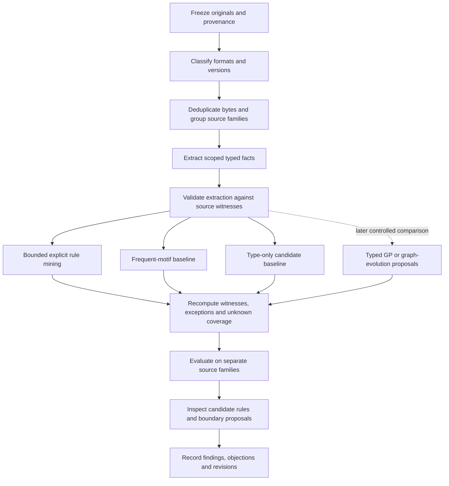

# Paper 6 — Curated Research Foundation

Status: primary-source literature review and proposed design; no mining experiments, workflow execution, or claims of empirical results. Accessed 30 October 2026. This is a focused initial review, not a systematic or exhaustive review.

## Main finding

Use one provenance-preserving, typed relational representation, then expose separate views for motif discovery, explicit rule mining, boundary proposals and possible evolutionary search. These are different tasks. A recurring subgraph is evidence of recurrence; a conditional rule adds a stated antecedent, consequent and denominator; a reusable composite additionally needs an interface, purpose and obligations. None establishes behavioral correctness by itself.

**Recommendation, not a literature theorem:** begin with bounded explicit relational rules and exact evidence accounting. Use graph motifs as a comparison and candidate source. Treat typed genetic programming or graph evolution as a subsequent candidate-search comparison once the representation, legality checks and scoring protocol exist. NEAT is relevant inspiration for preserving innovation and exploring topology; it is not an existing Langflow-composition algorithm.

## Curated primary sources

Each item states what was actually consulted. An abstract-level source is not represented as a full-paper review. No reported speedup is transferred to our corpus.

| ID | Primary source and inspected material | Established contribution | Assumptions and limits | Application to Paper 6 |
|---|---|---|---|---|
| S1 | Lajus, Galárraga, Suchanek (2020), [Fast and Exact Rule Mining with AMIE 3](https://pmc.ncbi.nlm.nih.gov/articles/PMC7250613/), full article, especially support/confidence, PCA and pruning | Mines relational rules with exact scoring options and bounded language/search settings; discusses alternatives for incomplete evidence. | Exactness concerns its configured rule space and metrics, not truth or useful software composition. Partial Completeness Assumption is a modeling assumption; absence is not inherently a negative. | Define explicit rules and denominators; compare observed-world and completeness-qualified metrics. Do not adopt PCA silently. |
| S2 | Yan and Han (2002), [gSpan: Graph-Based Substructure Pattern Mining](https://sites.cs.ucsb.edu/~xyan/papers/gSpan-short.pdf), author-hosted paper | Canonical minimum DFS codes support search for frequent connected labeled subgraphs; support counts graphs containing a pattern. | A frequent pattern is not an implication, abstraction boundary or behavior contract. Selected implementation must demonstrably preserve direction, labels and port distinctions. | Motif baseline and candidate generation. Keep graph-level support distinct from occurrence counts and family-level support. |
| S3 | van der Aalst, ter Hofstede, Kiepuszewski, Barros, [Workflow Patterns](https://www.vdaalst.com/publications/p108.pdf), author-hosted paper, introduction and pattern descriptions | Names recurring control-flow requirements such as sequence, split and synchronization, independent of a single product. | The catalog is a semantic vocabulary, not automatic rule mining. A data edge alone does not establish control-flow or concurrency semantics. | Label relation kinds explicitly; use patterns as interpretation prompts and competing explanations rather than training truth. |
| S4 | Leemans (2015), [Process Discovery and Exploration](https://leemans.ch/publications/papers/dc2014leemans.pdf), full short paper | Frames process discovery from execution event logs, distinguishes fitness, precision and generalization, and discusses rediscoverability assumptions. | Our static template graphs are not execution traces. Historical state-of-the-art statements in this paper are not current claims. | Borrow the separation of fit, overgeneralization and future-case behavior; do not claim an event-log discovery method applies unchanged to templates. |
| S5 | Langflow, [Components overview](https://docs.langflow.org/components/), official documentation: ports, dynamic ports, output selection and versions | Components expose typed ports; configuration can affect ports and selected outputs. Saved occurrences can retain an older component state. | Current online documentation may differ from archived exports. Type compatibility and current names do not prove historical compatibility or task success. | Extract from each saved occurrence and pin its evidence. Preserve native type/version, port handle, output selection, required fields and uncertainty. |
| S6 | Fong (2016), [The Algebra of Open and Interconnected Systems](https://arxiv.org/abs/1609.05382), author abstract | Develops compositional mathematics for networks of components with typed terminals using hypergraph categories and related constructions. | This review inspected the abstract, not its proofs. No categorical laws or semantic preservation are established for our JSON representation without an explicit interpretation. | Model an assembly as an open graph with an external interface; preserve boundary mappings when packaging. Formal inspiration, not an imported proof. |
| S7 | Speranzon, Spivak, Varadarajan (2018), [Abstraction, Composition and Contracts: A Sheaf Theoretic Approach](https://arxiv.org/abs/1802.03080), author abstract | Distinguishes wiring, behavior and abstraction for interconnected systems through a common formal framework. | Abstract-level inspection; adapting its semantics requires actual behavioral models. Static templates supply insufficient evidence for that alone. | Keep structural fit, declared behavior and validated behavior as separate fields. Boundary proposals cannot silently inherit behavioral guarantees. |
| S8 | W3C (2017), [Shapes Constraint Language](https://www.w3.org/TR/shacl/), official Recommendation: abstract, shapes and validation model | Separates data graphs from graph-expressed constraints used for conformance checking. | SHACL is for RDF and checks declared constraints. It is not itself a workflow miner, synthesizer or proof of operational correctness. | Adopt the separation of data, constraints and validation report. RDF/SHACL is an optional adapter, not a prerequisite for JSON interchange. |
| S9 | W3C (2013), [PROV-O](https://www.w3.org/TR/prov-o/), official Recommendation: entities, activities, derivation and revision | Represents derivation chains and responsibility across data artifacts and processing activities. | A recorded origin is an audit trail, not a guarantee of authenticity, licensing sufficiency or validity. | Trace source export → normalized graph → fact → rule witness → candidate composite; preserve duplicate origins and extraction version. |
| S10 | DEAP, [Genetic Programming](https://deap.readthedocs.io/en/master/tutorials/advanced/gp.html), official implementation tutorial, especially strongly typed GP | Provides explicit primitive/terminal types and type-matched tree construction, with implementation caveats on available terminals. | This is implementation documentation, not the original Montana paper or evidence about our task. Tree representations do not naturally preserve shared DAG substructure. | Candidate approach for evolving rule expressions or typed constructor programs. Grammar completeness, depth bounds, deterministic validation and scoring remain ours to design. |
| S11 | Miller and Thomson (2000), [Cartesian Genetic Programming](https://link.springer.com/chapter/10.1007/978-3-540-46239-2_9), original publisher abstract | Encodes programs as indexed graphs using connection/function genes and studies evolutionary search and neutrality on example tasks. | Publisher abstract inspected; attempted repository PDF was inaccessible. Original benchmark success does not establish compatibility with Langflow resource semantics, ports or composite boundaries. | More direct graph-search inspiration than evolving neural weights. Require typed gene references, bounded topology operators and a separate legality/evidence evaluator. |
| S12 | Stanley and Miikkulainen (2002), [Evolving Neural Networks through Augmenting Topologies](https://nn.cs.utexas.edu/downloads/papers/stanley.ec02.pdf), original author-hosted paper, topology mutation, historical markings and ablations | Evolves neural topology and weights; aligns inherited structures, protects variation through speciation and grows structure. | Neural activation/weight semantics differ from workflow components. A new encoding, constraints and task-specific fitness are necessary; fast learning of our rules is unestablished. | Consider lineage, diversity and incremental growth as design ideas. Do not rename a workflow graph search NEAT unless its adaptation is specified and compared. |
| S13 | scikit-learn, [Cross-validation: grouped data](https://scikit-learn.org/stable/modules/cross_validation.html#cross-validation-iterators-for-grouped-data), official implementation documentation | Group-aware splits prevent the same specified group from appearing in both training and testing; group sizes can be imbalanced. | Quality depends on correct groups. Splitting by repository alone does not stop copied templates crossing splits. | Group graph variants by source lineage/content families before splitting; record uncertainty and family-balanced as well as graph-weighted summaries. |
| S14 | Cawley and Talbot (2010), [On Over-fitting in Model Selection and Subsequent Selection Bias in Performance Evaluation](https://www.jmlr.org/papers/v11/cawley10a.html), original journal abstract | Shows that optimizing a finite-sample model-selection criterion can itself overfit and bias evaluation. | Abstract-level inspection. It supplies no numeric sample requirement or guaranteed correction for this corpus. | Separate development tuning from evaluation; record every inspection and reserve fresh families for changed hypotheses. Miners, thresholds and evolutionary fitness all create selection opportunities. |

## What the five research tracks establish—and leave open

| Track | Useful insight from sources | Unresolved question for our machine | Decision now |
|---|---|---|---|
| Graph rule mining | Relational implications and graph motifs have different outputs and scoring units (S1–S2). | Which relation language captures useful formation knowledge without memorizing source IDs? | Use explicit typed relations; compare conditional rules and motifs. |
| Workflow discovery | Named semantic patterns and trace-derived models are distinct (S3–S4). | Which semantics are actually declared in archived Langflow exports? | No inferred sequence/parallelism merely from layout or untyped topology. |
| Typed composition | Interfaces, constraints and semantics deserve separate representations (S5–S8). | What is a valid external boundary and which obligations survive packaging? | Preserve all crossing edges and unresolved required inputs; mark behavior unknown. |
| Genetic computation | Typed programs, indexed graph genomes and neural topology evolution offer different search spaces (S10–S12). | Do evolutionary proposals outperform bounded enumerative/motif-guided search under the same budget? | Keep an evolution-ready representation, but defer selecting a winner until a controlled comparison. |
| Evaluation and provenance | Derivation chains and grouped, selection-aware evaluation address distinct risks (S9,S13–S14). | How reliably can source families and missingness be identified? | Freeze and audit lineage; disclose uncertain grouping and unknown evidence. |

## Section-specific curation for the fourteen sections

These notes identify a concrete contribution to each manuscript section. They are not experiment results.

| Paper section | Sources | Insight to incorporate | Decision / unresolved work | Suggested visual |
|---|---|---|---|---|
| 1. Research question and scope | S1–S4 | Separate mining observed relationships from synthesizing useful abstractions and learning execution behavior. | Ask whether rules generalize across source families and support inspectable boundary proposals; behavioral claims out of scope initially. | Three-column distinction: motif, implication, composite proposal. |
| 2. Context and assumptions | S3–S7 | Existing work already distinguishes control semantics, interfaces and behavior. | Cross-reference Papers 1–5 by exact version before claiming a new contribution. | Prior-work-to-design map. |
| 3. Hypotheses and falsification | S1–S2,S14 | High support can coexist with weak predictive specificity or selection bias. | Hypothesize incremental usefulness over frequency/type-only baselines; define refutation before evaluation. | Claim → alternative → discriminating observation table. |
| 4. Corpus and sampling | S5,S9,S13 | Versioned occurrence evidence and source lineage matter independently of byte deduplication. | Pin manifest, classify format/fixtures, deduplicate exact files, group copied variants; no random edge split. | Inclusion funnel and source-family distribution from frozen data only. |
| 5. Representation | S5–S9 | Open boundaries, typed port relations and provenance must be representable together. | Use scoped relational facts and separate structural/behavioral judgments. | Annotated export → graph → fact trace. |
| 6. Mining method | S1–S2,S10–S12 | Rule language, canonicalization and search bias determine what can be found. | Start with small bounded connected Horn-like rule bodies; motif and typed-search baselines; disclose any completeness assumptions. | Method comparison by representation, output and assumption. |
| 7. Implementation | S5,S8–S10 | Data, constraints, validation output and derivation activity are separate artifacts. | Pin extractor/miner/config versions; emit witnesses and errors; never execute source workflows during analysis. | Artifact dependency graph. |
| 8. Evaluation | S1–S4,S13–S14 | Fit, generalization, absence assumptions and tuning leakage are distinct issues. | Test known fact extraction, exact rule counts, unseen-family transfer and boundary preservation separately. | Development/tuning/evaluation separation. |
| 9. Results | S1–S2,S13 | Counts require their support unit and population. | Report occurrence-, graph- and family-based measures separately, with explicit unknown coverage; no results currently. | Distribution and baseline plots after runs only. |
| 10. Defense | S3–S7,S14 | Semantic usefulness cannot be defended by frequency or type fit alone. | Challenge each claim with copied-family, vendor-default, representation-bias and missing-data explanations. | Objection → evidence → remaining uncertainty table. |
| 11. Learning and revisions | S9,S12,S14 | Lineage and controlled changes make improvement claims inspectable. | Preserve all revisions and selection decisions; do not reuse exposed evaluation as fresh evidence. | Revision lineage with hypothesis changes. |
| 12. Limitations | S1,S4–S7,S13–S14 | Incompleteness, static-vs-executed data and family dependence constrain interpretation. | Explicitly bound portability, runtime validity, inferred purpose and external validity. | Threat → effect → mitigation matrix. |
| 13. Outcomes | S1–S2,S6–S7 | Candidate rules and proposed abstractions are different research outputs. | Outcomes may be useful rules, rejected hypotheses or insufficient evidence; avoid claiming emergence. | Evidence ladder from source fact to task validation. |
| 14. Review and reproducibility | S9,S13–S14 | Derivation and evaluation exposure should be auditable. | Freeze reproduction package and review claim-to-evidence links; identify internal AI review honestly. | Claim/evidence/reviewer response ledger. |

## Proposed common representation

This is a design synthesis informed by S1–S2 and S5–S12, not a schema provided by any single source. Keep JSON as interchange; derive mining-specific views from it without changing native components.

| Record | Minimum content | Why it is separate |
|---|---|---|
| SourceArtifact | original URL, immutable revision or explicit unknown, path, hash, collection time, license reference, source family | Many origins can share identical bytes; provenance remains many-to-one. |
| GraphOccurrence | artifact reference, nested graph path, native schema/version evidence, graph ID | One export can hold more than one graph. |
| ComponentOccurrence | graph-local ID, native definition/type/version reference, role label separately | Two Agent occurrences remain two occurrences of one type. |
| PortOccurrence | owner, direction, stable handle, declared accepted/emitted types, requiredness, selected output, dynamic-context evidence | A component-type pair does not uniquely identify a legal connection. |
| RelationFact | predicate, typed arguments, graph scope, evidence location, extraction version, observed/derived/unknown judgment | Facts may be reified for provenance; mining views can flatten them under declared mappings. |
| ConfigurationDependency | component/port reference, resource kind, required setting, external binding reference, missingness | Never store credential values in mining facts. |
| BoundaryProposal | members, internal edges, crossing-edge map, exposed required ports, scope/purpose hypothesis, unresolved obligations | A motif lacks these interface and obligation decisions. |
| CandidateRule | rule ID, typed variables, antecedent atoms, consequent, applicability conditions, unknown/negative policy, search bounds | Conditional structure must be inspectable, not only a name or score. |
| RuleEvidence | frozen corpus, graph/family/grounding witnesses, counterexamples, unknown cases, support/confidence definitions, selection history | Scores must be reproducible and must not erase exceptions. |
| EvolutionCandidate | rule or graph genome, operators, parentage, generation/seed, hard-constraint report, score vector | A search proposal is not a new native component or validated library item. |

Useful relation vocabulary to specify: `instanceOf`, `ownsPort`, `acceptsType`, `emitsType`, `connects`, `requiresResource`, `memberOf`, `crossesBoundary`, and `derivedFrom`. Every fact is scoped to a graph/source; unrestricted joins across unrelated templates would manufacture assemblies that were never observed. Port attributes and n-ary facts can be represented as explicit entities/records and projected to binary views when required by a miner.

### Example rule form (symbolic only)

`instanceOf(x, A) ∧ ownsPort(x, p) ∧ emitsType(p, T) ∧ instanceOf(y, B) ∧ ownsPort(y, q) ∧ acceptsType(q, T) ⇒ connects(p, q)`

This asks whether compatible typed A/B occurrences are connected under additional declared conditions. It does **not** say all compatible occurrences should connect. Define the opportunity population first: which x/y pairs count, whether required/optional ports differ, and which absent edges can be judged. Otherwise confidence can be meaningless. Source type names in a real rule come from the pinned corpus, not invented primitives.

### Evidence definitions to settle before coding

| Measure | Proposed definition / condition | Important limit |
|---|---|---|
| Graph support | Number of distinct eligible normalized graphs with at least one witnessed body-and-head grounding | Counts a graph once regardless of repeated occurrences. |
| Family support | Number of source families with witnessed body-and-head grounding | Requires explicit, audited family assignment. |
| Grounding confidence | Supported body-and-head groundings divided by assessable body groundings | Must define grounding identity, opportunity set and head completeness. |
| Unknown coverage | Body groundings whose head cannot be assessed, divided by all considered body groundings | Do not quietly remove unknowns and imply universal applicability. |
| Counterexamples | Assessable body groundings with explicitly contradicted or completeness-qualified absent head | Absence under an open-world policy is not a counterexample. |
| Boundary conformance | Separately checked crossing-edge and required-port preservation | Static conformance does not measure useful behavior. |

Graph-level support and AMIE head-prediction support are not interchangeable. Implementations must name the convention actually used. Family-aware numbers reduce mirror dominance but do not prove causal independence.

## Bounded pipeline and evolutionary branch

Hard legality constraints should be checked separately from soft utility scores. Proposed evolution operators include type-preserving edge changes, bounded component insertion from the pinned library, and subgraph replacement preserving the declared interface. Each is a hypothesis about a useful search neighborhood, not a fact established by S10–S12. Required inputs, resource bindings and boundary mappings must survive or become explicit gaps. Cycles should follow a declared representation profile rather than assuming every archived Langflow export is a DAG.

For a fair later comparison, give bounded enumeration, motif-guided proposals and evolution the same eligible library, constraints, evaluation population and compute budget. Report search failures and variance across seeds. A fitness based only on corpus frequency will optimize resemblance, not task success. Introduce purpose/behavior objectives only when independent reference judgments or executable tests actually exist.

## Immediate research decisions and open questions

| Decision | Current recommendation | Evidence basis | Still open |
|---|---|---|---|
| Canonical data | JSON typed relational records with provenance; optional RDF/miner adapters | S1,S5–S9 | Exact schema and schema-validation implementation. |
| First mining output | Small explicit conditional rule with exact witnesses | S1–S2 | Rule grammar, thresholds and head missingness policy. |
| Evolution | Preserve extensibility; compare typed GP/graph evolution after baseline | S10–S12 | What is evolved: rules, constructor programs, graph topology or ranking policy? |
| Process mining | Use conceptual distinctions; no direct event-log claims | S3–S4 | Whether future runtime traces will be collected. |
| Evaluation | Source-family-separated tuning and evaluation; exact duplicates never cross splits | S13–S14 | Family classifier, exposure register and independent reference judgments. |
| Composite formation | Treat boundary/purpose as hypotheses beyond recurring topology | S5–S7 | Formation contract and evidence of usefulness. |

## Review limitations

The source list is curated, not exhaustive. S6, S7, S11 and S14 were reviewed at abstract level; they support the limited descriptions above, not detailed theorem or algorithm reuse. The CGP repository full text and author tutorial timed out/failed; the original publisher abstract was accessible. DEAP documentation supplies a verified implementation route but is not a substitute for reviewing Montana's original strongly typed GP paper before attributing historical details. No implementation was installed, selected as a final winner or benchmarked during this review.

The next justified implementation milestone is a frozen extraction-and-rule example with independently checkable witnesses and an explicit absence policy. It is not autonomous generation of all layers.
