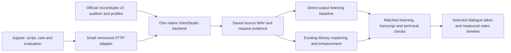

# VoiceStudio adoption audit

Audited October 30, 2026. Main revision `4d4cb0badf99c7518e3f4c69487df6e8bfeff43f`; selected stable comparison `v0.5.7` / `beeaae08204f0de5f49d4a087ef2b0ea8fecfcb9`. **Static primary-source audit, not a runtime quality/security certification.** The source was downloaded to a read-only audit checkout. No application, dependency environment, models, or services were installed or launched. Current host checks: Apple Silicon / arm64, 64 GiB unified memory, about 1.3 TiB available storage.

## Recommendation

**Use the official native backend as a separately managed local speech service, call its full API from Jupyter, and optionally attach its existing desktop interface for voice selection and listening.** Start with a pinned stable source revision and one model at a time. Avoid copying its engine internals into our application. This gives automation and the existing voice studio without rebuilding either. The Electron shell can attach to an existing backend instead of starting another. [Lifecycle and attach behavior](https://github.com/debpalash/VoiceStudio/blob/4d4cb0badf99c7518e3f4c69487df6e8bfeff43f/electron/README.md#L27-L53).

The current stable tag contains the native generation route, OpenAI-compatible speech and voice-list routes, MCP implementation, MLX Dia/CSM models and full VoxCPM2 class; these were checked with `git show` at that tag. Detailed engine-control findings are pinned to main in [ENGINE-REVIEW.md](ENGINE-REVIEW.md); selected-release schemas still need a running OpenAPI and inference check before an adapter is declared operational.

| Route | Strength | Cost / limitation | Fit here |
|---|---|---|---|
| Packaged Apple Silicon Mac app, then API | Official interface, managed runtime/setup, minimal development setup | App-managed backend lifecycle; release features can lag main | Viable if interactive audition is the immediate priority |
| Pinned native source backend + API, desktop attaches optionally | Reproducible version, explicit storage and process lifetime, full automation | We own environment setup and health/restart management | **Recommended for our notebook/pipeline work** |
| Extract individual model implementations | Maximum freedom | We inherit model loading, upgrades, formats, profiles and bug fixes | Defer; use only for a proven API gap |
| Docker on this Mac | Containerized service | Linux containers do not expose Apple MPS/MLX; CPU/emulation is not equivalent | Avoid for local accelerated speech |

Sources: [Mac installation](https://github.com/debpalash/VoiceStudio/blob/4d4cb0badf99c7518e3f4c69487df6e8bfeff43f/docs/install/macos.md), [Docker architecture](https://github.com/debpalash/VoiceStudio/blob/4d4cb0badf99c7518e3f4c69487df6e8bfeff43f/docs/install/docker.md#L19-L32), [locked source setup](https://github.com/debpalash/VoiceStudio/blob/4d4cb0badf99c7518e3f4c69487df6e8bfeff43f/scripts/setup-api.mjs#L14-L58).

## Proposed connection to what we already have

This is an integration proposal, not installed architecture. VoiceStudio would replace only the speech-generation choice when selected; our current F5 path remains a regression baseline. Keep source audio before processing. Evaluate VoiceStudio's own processing against Money's chain rather than stacking mastering automatically. Native `effect_preset="raw"` bypasses the app-added DSP, though engine-internal processing and provenance marking can remain. [DSP implementation](https://github.com/debpalash/VoiceStudio/blob/4d4cb0badf99c7518e3f4c69487df6e8bfeff43f/backend/api/routers/generation.py#L654-L701), [audio controls and raw caveat](https://github.com/debpalash/VoiceStudio/blob/4d4cb0badf99c7518e3f4c69487df6e8bfeff43f/docs/audio-quality.md#L22-L55).

## What “many voices” actually means

Engine choices, downloaded weights, saved voice identities, design recipes, and preview clips are separate inventories. Familiar OpenAI-style names in the compatibility API are aliases to an active engine default, not copies of those hosted voices and not necessarily distinct speakers. Gallery recipes must be rendered; they are not a bundled cast ready for every engine. Use explicit saved profile IDs and inspect engine capabilities. [Alias construction](https://github.com/debpalash/VoiceStudio/blob/4d4cb0badf99c7518e3f4c69487df6e8bfeff43f/backend/api/routers/openai_compat.py#L1290-L1338), [gallery evidence and engine matrix](ENGINE-REVIEW.md).

For our first conversational tests:

1. **MLX Dia:** one complete English speaker-tagged exchange. Tests whether whole-dialogue generation gives better turn-to-turn prosody.
2. **Full VoxCPM2:** a selected male/female cast with reference or designed voices and written delivery direction. Its adapter declares MPS support; prove actual acceleration in a run. Do not confuse it with the MLX VoxCPM conversion, which has different cloning/design capabilities.
3. **Optional MLX CSM:** reference-conditioned identity consistency if the first two do not meet that need.

Stories/longform supports casting, pauses, chunking and joining, but the inspected generic loop does not pass accumulating conversation history. A conversational label is not proof of natural exchanges. See the source-linked [engine review](ENGINE-REVIEW.md) for exact model IDs, platform declarations and uncertainty.

## API/control contract

| Interface | Observed implementation | Use |
|---|---|---|
| Native REST | `POST /generate` accepts engine, profile/reference, instruction, seed, duration, sampling, emotion fields where supported, effects and WAV precision | Primary notebook integration; preserves full controls |
| OpenAI-compatible | `POST /v1/audio/speech`, transcription/translation, models and voices | Convenient generic clients; not every native control is represented |
| MCP | Mounted `/mcp/`; generation, profiles/design, transcription and health | Later agent collaboration; use file-output mode and a confined base directory |
| Profiles | Saved identity records through `/profiles` | Cast selection and reproducible profile IDs |
| Stories / longform | Chunked production, progress and joins | Longer scripts after the short-dialogue experiment |

Sources: [native fields](https://github.com/debpalash/VoiceStudio/blob/4d4cb0badf99c7518e3f4c69487df6e8bfeff43f/backend/api/routers/generation.py#L1825-L1879), [OpenAI request schema](https://github.com/debpalash/VoiceStudio/blob/4d4cb0badf99c7518e3f4c69487df6e8bfeff43f/backend/api/routers/openai_compat.py#L243-L346), [MCP contract](https://github.com/debpalash/VoiceStudio/blob/4d4cb0badf99c7518e3f4c69487df6e8bfeff43f/docs/mcp.md#L1-L85), [profile routes](https://github.com/debpalash/VoiceStudio/blob/4d4cb0badf99c7518e3f4c69487df6e8bfeff43f/backend/api/routers/profiles.py), [Stories](https://github.com/debpalash/VoiceStudio/blob/4d4cb0badf99c7518e3f4c69487df6e8bfeff43f/docs/electron-longform.md#L9-L15).

A full adapter should:

- Read health/build version and enumerate engines, model readiness, profile IDs and expression capabilities before a request. Package presence is not loaded-model proof.
- Pin engine/model revision, voice identity, language, seed, expression, decoding options and DSP policy. Validate unsupported controls before generation; do not assume every engine accepts happy/sad tags. Compatibility-style instructions can be filtered for tag-only engines. [Instruction handling](https://github.com/debpalash/VoiceStudio/blob/4d4cb0badf99c7518e3f4c69487df6e8bfeff43f/backend/api/routers/openai_compat.py#L611-L626).
- Save the returned WAV locally, hash it, and keep the exact request plus duration/seed/routing response metadata. Reject/report dropped text chunks, unexpected fallback and timeout. The native route returns a binary WAV, not a JSON audio object. [Response headers/body](https://github.com/debpalash/VoiceStudio/blob/4d4cb0badf99c7518e3f4c69487df6e8bfeff43f/backend/api/routers/generation.py#L2738-L2775).
- Preserve takes in our research run directory immediately rather than relying on a historical backend URL: unstarred takes can be pruned over the configured history cap. [Retention](https://github.com/debpalash/VoiceStudio/blob/4d4cb0badf99c7518e3f4c69487df6e8bfeff43f/backend/api/routers/generation.py#L2889-L2907).
- Measure timing from actual WAVs; avoid untested sample-rate assumptions. Generate a short turn first, then a dialogue, then a longer batch.

## Native Mac operation and isolation

Keep a pinned checkout and launcher/configuration under our control. Give VoiceStudio its own Python environment, application data, Hugging Face cache and managed engine environments; do not install into Money's F5 environment. The project supports `OMNIVOICE_DATA_DIR`, cache configuration and `OMNIVOICE_ENGINES_DIR`. Its default Mac data directory is under Application Support/OmniVoice. [Data/engine paths](https://github.com/debpalash/VoiceStudio/blob/4d4cb0badf99c7518e3f4c69487df6e8bfeff43f/backend/core/config.py#L5-L15), [engine directory override](https://github.com/debpalash/VoiceStudio/blob/4d4cb0badf99c7518e3f4c69487df6e8bfeff43f/backend/core/config.py#L70-L85), [cache redirect](https://github.com/debpalash/VoiceStudio/blob/4d4cb0badf99c7518e3f4c69487df6e8bfeff43f/backend/main.py#L140-L166).

Native backend defaults to loopback port 3900; it supports another configured port. Launch one owned backend and attach the UI, avoiding two runtimes competing for the same port or loading duplicate model sets. No install should stop our existing Jupyter, audio workbench or model server. The source web-development command invokes a port-clearing preparation helper, so it is not the right unattended launcher for this shared workspace. [Default binding](https://github.com/debpalash/VoiceStudio/blob/4d4cb0badf99c7518e3f4c69487df6e8bfeff43f/backend/main.py#L2225-L2235), [development scripts](https://github.com/debpalash/VoiceStudio/blob/4d4cb0badf99c7518e3f4c69487df6e8bfeff43f/package.json#L7-L25), [dev backend launch](https://github.com/debpalash/VoiceStudio/blob/4d4cb0badf99c7518e3f4c69487df6e8bfeff43f/scripts/dev-backend.mjs#L35-L65).

64 GiB is a reasonable host for a bounded native trial; it is not proof that every engine can be loaded together. Run one candidate at a time, release it between comparisons, and measure cold/warm startup, memory pressure and real-time factor. Download only the selected model and required dependencies. Default MCP generation can download a missing model on first use, so a future setup must explicitly preflight/download chosen assets and record progress rather than treating the first generation as a quick health test. [MCP first-use behavior](https://github.com/debpalash/VoiceStudio/blob/4d4cb0badf99c7518e3f4c69487df6e8bfeff43f/docs/mcp.md#L28-L39).

## Boundaries found during audit

- **Local API authentication:** the inspected API-key middleware explicitly bypasses loopback requests; setting a key is not equivalent to authenticating same-host callers. Keep this local single-user service on loopback. Remote access needs a separate design; not part of this adoption. [Middleware](https://github.com/debpalash/VoiceStudio/blob/4d4cb0badf99c7518e3f4c69487df6e8bfeff43f/backend/main.py#L1896-L1908).
- **Installer documentation conflict:** the v0.5.7 release page reports Developer-ID signed/notarized Mac installers, while the checked-in Mac guide describes unsigned/ad-hoc workarounds. Verify the actual selected installer/signature if using a DMG; do not assume either prose is proof and do not automatically bypass OS protections. [Release signing statement](https://github.com/debpalash/VoiceStudio/releases/tag/v0.5.7), [guide](https://github.com/debpalash/VoiceStudio/blob/4d4cb0badf99c7518e3f4c69487df6e8bfeff43f/docs/install/macos.md).
- **App versus model terms:** the application is AGPL-3.0-only; the default OmniVoice weights are separately marked noncommercial/restricted. A local licence-acceptance click does not grant commercial permission. Alternative model distributions need their own weight/component/reference review; a registry entry marked unreviewed is not itself an upstream prohibition. [Application metadata](https://github.com/debpalash/VoiceStudio/blob/4d4cb0badf99c7518e3f4c69487df6e8bfeff43f/pyproject.toml#L3-L13), [model registry](https://github.com/debpalash/VoiceStudio/blob/4d4cb0badf99c7518e3f4c69487df6e8bfeff43f/backend/config/model_licenses.json#L1-L40), [detailed engine findings](ENGINE-REVIEW.md).
- **Main versus stable:** main has substantial changes beyond stable. This report pins both and checks selected stable API/model paths; never silently combine a stable app with assumptions from a newer main branch.

## Staged adoption and success criteria

| Stage | Deliverable | Gate |
|---|---|---|
| 1. Isolated native service | Pinned release, dedicated environment/data/cache, one reachable backend | Health/version/OpenAPI verified; existing services preserved; selected model ready |
| 2. One real utterance | WAV generated through native REST and saved with metadata | Decodable audible audio; selected engine/profile used; actual device and resource behavior observed |
| 3. Conversational audition | Same short two-character script across Dia, full VoxCPM2 and current F5 baseline | Listen blind for naturalness, identity, pacing and direction; record omissions/repeats with ASR plus listening |
| 4. Production comparison | Direct and Money-processed versions, loudness-matched | Choose on listening evidence; no automatic double processing |
| 5. Notebook adapter | Reusable request-to-WAV contract with sources/settings/errors | Repeated renders, invalid input, missing model, busy/timeout and file preservation checked |
| 6. Optional UI/agent access | Official desktop attaches; MCP file mode if useful | Same backend/cast and bounded file directory; no second copy of model assets |

Use a fresh dialogue in addition to Paper 13's known script. Evaluate complete-turn playback, two questions, calm-to-excited shifts, names/numbers, pauses and a repeated line. Record word omissions/repetitions, elapsed time per audio-second, memory, source format, per-turn loudness and processing choice. **A successful API call does not establish natural conversational delivery.** ASR helps find textual mistakes but does not replace listening.

## What this audit establishes

There is a viable source/API/UI architecture and a defensible shortlist of experiments. It does **not** establish installed readiness, actual Mac inference speed, superior voices, a licensing clearance, full offline operation under every optional provider, or error-free runtime behavior. No installation was performed. The next concrete deliverable is the isolated native service plus one real API-generated audition, followed by the controlled dialogue comparison.
