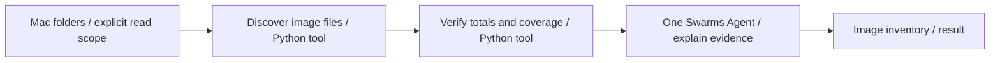

# Single-agent image discovery — local code audit

Audited the checked-out Swarms source, October 13, 2026.

## Library findings

- `swarms/structs/agent.py:290`: `Agent` is a single stateful agent. Its constructor accepts Python callable `tools`, `max_loops`, `system_prompt`, model configuration, and optional planning controls. More loops are reasoning turns, not more agents.
- `swarms/structs/agent.py:1188`: Responses enter short-term memory; the tool manager parses and dispatches model tool calls and records their results before another request.
- `swarms/structs/agent.py:2542`: `Agent.run` accepts a task and optional messages; it can perform a multi-step reasoning flow.
- The seven canvas labels are application abstractions, not seven native Swarms node classes. Research is represented by a configured Agent; a Python callable is a separate capability.
- Swarms does not provide this application's folder permission selector, filesystem inventory implementation, or React Flow nodes. Those adapters belong to this application, without editing the upstream Swarms package.

## Implemented graph

This is a controller-owned deterministic tool pipeline feeding one Agent. It does not currently depend on autonomous model tool selection. Swarms supports that alternative, but exposing tools is not proof that the selected local model will call them correctly. The current graph intentionally makes accurate counting independent of model behavior.

## Missing UI components now supplied

A folder-scope source, a callable-tool node distinct from an agent, a deterministic verifier, and a result node. These appear in the dedicated project's draggable palette. The graph can be rearranged, connected, and deleted. Execution requires the seeded five-step flow; arbitrary extra branches are design-only. The project is selected independently of the running log pipeline.

## Counting contract

Metadata-only recursive enumeration of requested folders, recognized image extensions, case insensitive. No image contents opened, no writes to scanned files, no shell or MCP access given to the agent. Overlapping roots do not recount the same path. Symlinks are not followed; unreadable paths are exposed. Copies and hard links at different paths count as separate files. Physical files within Photos packages are not logical Photos assets. Extension recognition does not validate an image's bytes. Cloud-only files and unrequested/external volumes are not guaranteed covered. Live filesystem changes are not an atomic snapshot.

The default scope is the user's home folder, not every volume on the machine. Counts are marked partial when a requested path cannot be enumerated. Format and folder totals are verified against the total. The LLM explanation is separate from these authoritative numbers.

## Validation

Scanner fixture passed: mixed-case extensions, overlapping roots, symlink cycle, missing path disclosure, aggregation consistency, metadata-only enumeration. Frontend production build and browser-visible five-step graph passed. Live home-folder scan initiated through the visible Run image discovery control; final results recorded separately after completion.

## Live result

Visible browser run completed and persisted across reload: 2,184,360 entries checked across 252,154 directories; 72,548 image-extension files counted. Folder and format sums matched. 332 unreadable paths make coverage partial. The single EXO-backed Swarms Agent returned an explanation reproducing the exact count; its response hit the configured output limit, so the deterministic result and coverage badge are authoritative. Includes development assets and icons. Evidence: `image-discovery-live.png`.

## Universal node inspection follow-up

All three canvas node implementations now use `ui/NodeFrame.jsx`, which installs input and output trays by default. Existing agent input composition remains intact. Image stages expose their actual execution scope, inventory, verification, exact agent task string and response, and composed report. Histories persist with the image project, retain five entries per stage/direction, and deduplicate repeated polls. Unavailable stage timestamps are left blank rather than inferred.

Browser verification: all five image nodes have both trays populated (10 trays total); default locked-open state; click lock/unlock does not select the node. Original failure experiment retains its input composition gear and both agent trays; logs provider now has both trays and actual preview request/response. An isolated synthetic browser fixture verified input and output arrival flashes and exact output without changing the real 72,548-file inventory. Production build passed. Screenshot: `image-node-trays.png`.
